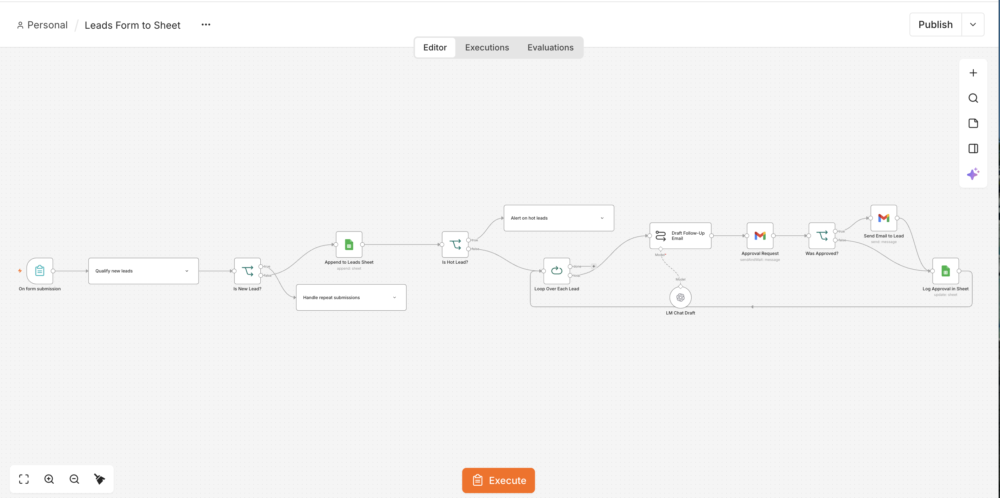
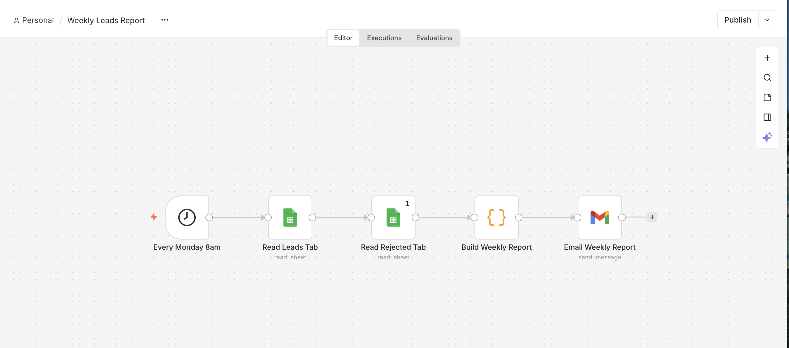
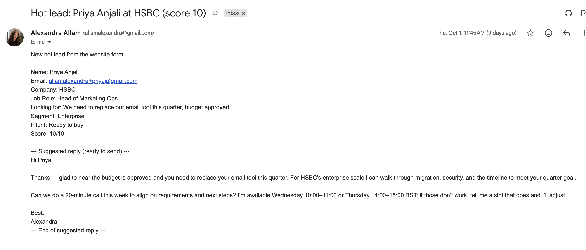
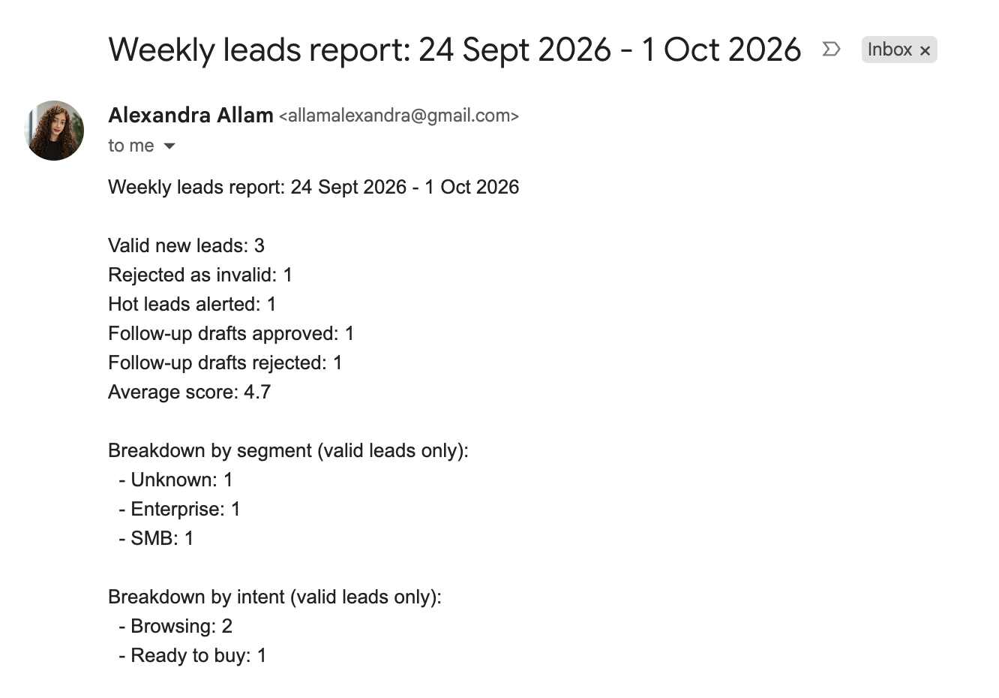

# AI lead qualification workflow

An n8n workflow that qualifies website form leads with AI and routes each one to the right next step. Personal project, built and tested with test data in September and October 2026.

Full case study and other projects: https://alexandra-allam.github.io

## What it does

1. **Form submission:** name, email, company, job role and "What are you looking for?"
2. **AI qualification:** the model returns a fixed structure: segment (SMB, Enterprise, Unknown), intent (Browsing, Evaluating, Ready to buy, Invalid) and a score from 1 to 10 based on a written rubric.
3. **Spam check:** leads with intent "Invalid" go to a Rejected tab. No emails are sent.
4. **Duplicate check:** a known email updates the existing row and increases its Submissions count.
5. **Hot lead check:** "Ready to buy" or a score of 9 or more sends an instant alert with a suggested reply.
6. **AI draft and approval:** every other lead gets a short AI-drafted follow-up, sent to me with Approve and Reject buttons. Only approved emails go to the lead.
7. **Logging:** every lead ends with a status in the sheet.

A separate workflow emails a weekly report every Monday: valid and rejected leads, hot leads, approval outcomes, average score and segment breakdown.

## Scoring rubric given to the AI

| Score | Meaning |
|---|---|
| 9-10 | Has budget and a timeline within 3 months |
| 7-8 | Actively comparing tools, no confirmed budget |
| 4-6 | Interested but no timeline |
| 1-3 | Just curious, a student, or no business need |

## Files

| File | Contents |
|---|---|
| `lead-qualification.json` | Main workflow |
| `weekly-leads-report.json` | Weekly report workflow |
| `test-leads.json` | Four test leads: a student, an enterprise buyer, a small business and a spam entry |
| `canvas.png`, `weekly-report-canvas.png` | The two workflow canvases |
| `hot-lead-alert.png`, `weekly-report.png` | Example output emails from test runs |
| `build-log.csv` | Every problem found during testing and how it was fixed |

## How to run it

1. In n8n, go to **Workflows → Import from file** and import `lead-qualification.json` and `weekly-leads-report.json`.
2. Connect your own accounts when n8n asks: Google Sheets, Gmail, and an AI model credential.
3. Create a Google Sheet with tabs **Leads** and **Rejected**, using these headers: `Timestamp, Name, Email, Company, Job Role, What are you looking for?, Segment, Intent, Score, Approval, Submissions`. Point the Sheets nodes at it.
4. Open the form trigger, set `test-leads.json` as mock data, and click **Execute workflow**.

Expected results: the enterprise buyer triggers a hot lead alert, the student and the small business each get an approval email, and the spam entry goes to the Rejected tab.

No credentials are stored in these files. All names and details in the test data are made up.

## Example outputs

## What testing found

- Spam and students were labelled as small businesses because the segment list had no fallback. Fixed by adding "Unknown" and "Invalid" options.
- The same lead got different scores on repeat runs. Fixed with an explicit scoring rubric, which gave identical scores across repeat runs.
- With two leads in one run, the approval step silently dropped the second. Fixed by looping over leads one at a time.
- The weekly report tripled the rejected count because a sheet-read step ran once per incoming row. Fixed by setting it to run once and checking every figure against the sheet.
- Spam was lowering the average score. The report now calculates quality metrics from valid leads only.

## How it was built

I used n8n's built-in AI assistant to generate the nodes. I designed the flow and categories, wrote the test cases, checked the results against the source data, and directed each fix.

## Next steps

- Split "Unknown" into "Unknown size" and "Individual".
- Send a reminder when a draft has waited 24 hours for approval.
- Add an error workflow that alerts on failed runs.
- Run it on a real business's form and measure response time to hot leads.

## About me

Alexandra Allam, London. MSc Marketing from Concordia University’s John Molson School of Business (2026), with a thesis on how advertising appeals shape consumer responses to wearable technology. First Class BSc in IT Management for Business from UWE Bristol. Background in workflow analysis and API integration. Looking for roles in marketing operations and MarTech.

Portfolio: https://alexandra-allam.github.io · LinkedIn: https://www.linkedin.com/in/alexandra-allam-b54370171
